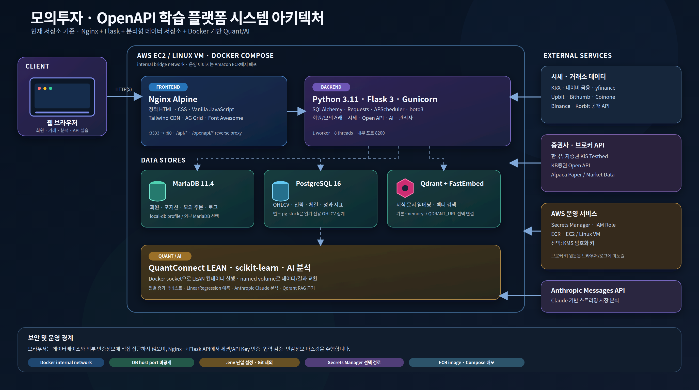
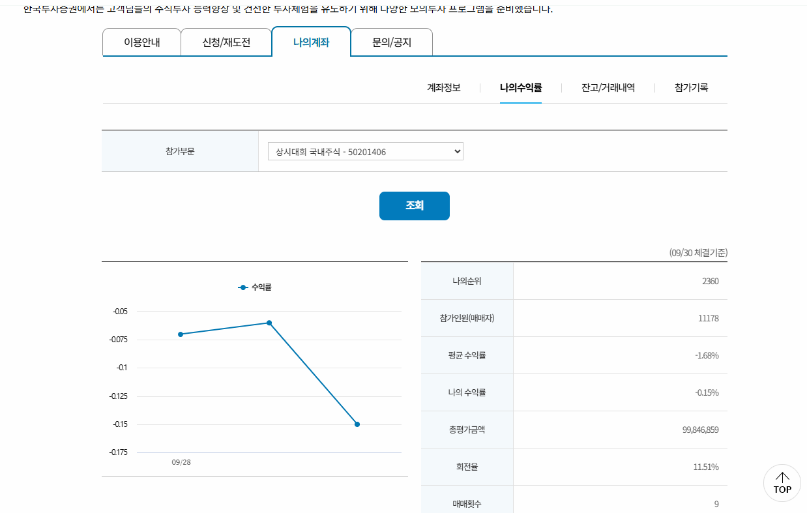

# Paper Trading · Open API Practice Platform

<p align="center">
  
</p>

## AWS Lambda and API Gateway; this repository's frontend runs on EC2
## Connect each user's alternative ML/DL AI resources

A stock and cryptocurrency paper-trading and Open API learning platform built with a FastAPI REST API and Vanilla JavaScript. It provides simulated domestic stock and crypto orders, alternative-asset exercises, an Open API for external integrations, and read-only connection tests for brokerages and the Alpaca Paper API.

> This is an educational and practice project. Brokerage and Alpaca connection tests only validate keys and perform read-only queries; the project does not provide automated live-order execution.

## Features

- Paper stock and crypto trading with sign-up/login, portfolio, and transaction-history views
- KRX stock quotes, charts, and search; crypto quotes and domestic exchange price comparisons
- Paper orders for alternative assets (futures, options, metals, and fractional real-estate ownership)
- AI Sheet: import tables from public web pages and create a monthly closing-price sheet (`yyyy-mm × symbol`) for the last 24 months for the top 20 stocks in each sector
  - Quant analysis: train scikit-learn `LinearRegression` on monthly closing prices through M-2, predict M-1, and compare with actual values (symbols are displayed in a fixed column)
  - LEAN: a test button runs a buy-and-hold backtest in QuantConnect LEAN (Docker) using monthly closing prices for selected stocks. See “Operational Considerations” below.
- Investment-analysis learning, Qdrant-based knowledge search, and AI analysis
- Issue Open API keys for external systems and provide APIs to connect a virtual stock account
- Hands-on practice learning pages:
  - TradingView (Pine)
  - KB Securities Open API
  - Korea Investment & Securities (KIS) API
  - Alpaca Paper Trading and Trading CLI
- Read-only connection tests for analysis tools:
  - `Broker Quote Test`: KIS Testbed quotes and KB Securities authentication status
  - `Alpaca Test`: Alpaca Paper account status
- (Optional) Connect the official Korea Investment & Securities KIS MCP server for VS Code and Codex; see “KIS MCP” below.

## Open API Practice Curriculum

The modular curriculum covers signing up for external platforms, obtaining keys, and safely practicing read-only queries and simulated trading in this web app. Do not include keys, secrets, or account numbers in submitted work.

| Course | Prerequisites | Exercises | Guide |
|---|---|---|---|
| KIS Testbed | KIS paper trading and API applications | Testbed queries and paper order → modify → cancel | [kis-test](frontend/learning/kis-test.html) |
| KB Open API | KB Open API application and keys | Read-only production quotes, order books, and charts | [kb-securities](frontend/learning/kb-securities.html) |
| Alpaca Paper | Alpaca Paper account and keys | Paper account and quotes; order → cancel flow | [alpaca-api](frontend/learning/alpaca-api.html) |

## Architecture

```text
Browser
  │
  ▼
Nginx Frontend (:3333)
  ├─ Static HTML / JavaScript / CSS
  ├─ /api/*      → FastAPI Backend
  └─ /openapi/*  → FastAPI Backend
                     │
                     ├─ MariaDB (members, web paper orders, audit logs)
                     ├─ PostgreSQL quant_research (quant time series, strategies, fills, performance)
                     ├─ PostgreSQL pg-stock (daily domestic stock data and aggregates)
                     ├─ Qdrant market_knowledge (currently in-memory RAG)
                     ├─ Redis 7.4 (server-side login sessions · 7-day TTL)
                     ├─ Domestic and international quote providers
                     └─ KIS / KB Securities / Alpaca Paper API (optional, read-only tests)
```

| Area | Components | Role |
|---|---|---|
| Frontend | Nginx, HTML, Vanilla JS, Tailwind CDN | UI, off-canvas menu, and API calls |
| Backend | FastAPI, Pydantic v2, SQLAlchemy 2.0, Redis server-side sessions, Requests | Members, login sessions, paper orders, quotes, Open API, and external API tests. See [python-stock-backend/README.md](python-stock-backend/README.md) for the layered structure. |
| Data | MariaDB, PostgreSQL Quant, PostgreSQL pg-stock, Qdrant, Redis | Service transactions, quant research, raw/aggregated stock data, AI search, and login state |
| Operations | Docker Compose | frontend, python-backend, redis, and mariadb/postgres (`local` profile) |

## Quick Start

### Requirements

- Docker Engine and Docker Compose v2
- Internet access and service keys may be required for external quotes and AI features.

### 1. Prepare the environment file

```bash
cp .env.example .env
```

`.env` is the only local configuration file and contains DB passwords, session keys, and brokerage/cloud API keys. Never commit real values to Git. Docker Compose reads `.env` automatically. When running `uvicorn app.main:app` directly, `app/core/config.py` reads `.env` from the repository root (already-set environment variables take precedence).

### 2. Configure external API credentials

No separate `*.key` files or `/run/secrets` fallback are used. Refer to the commented examples in [.env.example](.env.example) and enter only the values you need in `.env`.

```text
KIS_PAPER_APP_KEY=...
KIS_PAPER_APP_SECRET=...
KIS_PAPER_ACCOUNT_NO=12345678-01
KB_APP_KEY=...
KB_APP_SECRET=...
ALPACA_API_KEY=...
ALPACA_SECRET_KEY=...
```

### 3. Start the app

```bash
docker compose up -d --build
docker compose ps
```

Set `COMPOSE_PROFILES=local-db` in `.env` to start the local MariaDB profile as well.

### 4. Open the app

| URL | Description |
|---|---|
| <http://localhost:3333> | Web application |
| <http://localhost:3333/broker-api-test.html> | KIS Open API connection test |
| <http://localhost:3333/kis-api-explorer.html> | KIS API explorer (domestic-stock API catalog, calls, and response visualization based on official examples) |
| <http://localhost:3333/kis-chart.html> | KIS stock chart (Testbed period quotes and intraday minutes using paper keys in `.env`) |
| <http://localhost:3333/kis-api-history.html> | Grid of KIS internal API, external TR calls, and error history (login required) |
| <http://localhost:3333/alpaca-test.html> | Alpaca Paper API test |
| <http://localhost:3333/openapi.html> | External integration Open API specification |
| <http://localhost:3333/quant.html> | PostgreSQL Quant Lab |

Nginx proxies `/api/*` and `/openapi/*` to FastAPI. The browser sends API calls to the same origin.

Login sessions are stored server-side in Redis. The browser cookie contains only a signed session ID; the actual `member_id` is stored in a `stock-coin-trade:session:*` key with a seven-day TTL. A new session ID is issued after successful login or registration, and the Redis session is deleted on logout.

### 5. Stop the app

```bash
docker compose down
```

To remove local database volumes as well, use the following command. This deletes data, so use it with care.

```bash
docker compose down -v
```

## Public Multi-Asset Demo Accounts and Menus

Five public demo accounts are available at <https://st.edumgt.co.kr> for immediate exploration. Each includes stock, cryptocurrency, and alternative-asset positions. These accounts are for education and feature testing only; do not connect real personal information, live accounts, or external API keys. Because the accounts are public, do not change their passwords, enter personal information, or use them for real services.

| Investment style | ID (email) | Password | Preconfigured positions |
|---|---|---|---|
| Conservative | `multiasset-demo-01@edumgt.test` | `DemoMultiAsset2601` | Samsung Electronics · Bitcoin · gold |
| Balanced | `multiasset-demo-02@edumgt.test` | `DemoMultiAsset2602` | SK hynix · Ethereum · fractional Pangyo apartment |
| Growth | `multiasset-demo-03@edumgt.test` | `DemoMultiAsset2603` | NAVER · XRP · U.S. dollar futures |
| Real assets | `multiasset-demo-04@edumgt.test` | `DemoMultiAsset2604` | Hyundai Motor · Solana · KOSPI 200 call options |
| Derivatives | `multiasset-demo-05@edumgt.test` | `DemoMultiAsset2605` | POSCO Holdings · Cardano · KOSPI 200 leveraged |

Each account also has initial virtual cash. Multiple people share these public accounts, so orders, sales, and resets can change portfolio state.

The shared off-canvas menu on the left is used by every page through `frontend/js/common.js`.

| Menu | Main screens |
|---|---|
| Trading | Crypto, stocks, alternative assets |
| Asset Management | Holdings, transaction history, dollar-cost averaging calculator |
| Practice | TradingView (Pine), KB Securities, Korea Investment & Securities API, Alpaca API |
| Analysis · Tools | AI Sheet, Open API, broker quote test, Alpaca Test |

## API Overview

### Paper Trading Orders and Analysis API

All order APIs require a login session. The `preview` APIs only calculate whether an order could be executed based on current quotes, available cash, and holdings; they do not change orders, balances, or transaction history.

| Method | Path | Description |
|---|---|---|
| `POST` | `/api/stocks/orders/preview` | Preview estimated fill amount and cash/holding changes for a stock market order |
| `POST` | `/api/trade/order/preview` | Preview estimated quantity and amount for a crypto market buy/sell |
| `POST` | `/api/alternatives/orders/preview` | Preview margin/cash impact of futures, options, metals, and real-estate paper orders |
| `GET` | `/api/member/trading-activity?days=30` | Period trading count and turnover across stock, crypto, and alternative-asset fills |
| `GET` | `/api/member/portfolio-analysis` | Asset allocation, HHI diversification, leverage exposure, profit/loss, and sector concentration |

### PostgreSQL Quant API

The local `local-db` profile also runs PostgreSQL. On first startup, `database/quant-postgres.sql` initializes the monthly time-series schema and explicit sample OHLCV data. In production, set a separate PostgreSQL connection with `QUANT_DATABASE_URL`.

| Method | Path | Description |
|---|---|---|
| `GET` | `/api/quant/overview` | Loaded row counts and available symbols |
| `GET` | `/api/quant/market-data?symbol=005930` | Query partitioned OHLCV data |
| `GET` | `/api/quant/signals?symbol=005930&fast=20&slow=50` | Window-function-based moving-average signals |
| `POST` | `/api/quant/backtests` | Save strategies, fill logs, and performance metrics |
| `GET` | `/api/quant/results` | Saved strategies and transaction logs |

The web UI does not execute arbitrary SQL. It displays and runs only read-only, parameter-bound SQL templates, balancing convenient data access with protection of the production database.

### OHLCV Search and Major-Stock Data Collection

`/ohlcv-db.html` queries the separate `pg-stock` database with AG Grid Community. `/api/ohlcv-db/rows` supports filters for ticker, name, market, date range, closing price, and volume, as well as server-side pagination and sorting.

Daily data since 2020 for 24 major KOSPI and KOSDAQ stocks can be loaded repeatedly with the following commands. A composite primary key and upsert prevent duplicates when the same date range is loaded again. Naver Finance is the default provider; `--provider yahoo` and `--provider auto` are also supported.

```bash
docker compose exec python-backend python crawl_major_ohlcv.py
docker compose exec python-backend python crawl_major_ohlcv.py --ticker 005930 --start 2020-01-01
```

After the initial load, overall, yearly, and market aggregates are created once in `ohlcv_*_summary` snapshot tables. By default, the backend scheduler incrementally updates the current year daily at 09:50, 12:50, and 16:50 (Asia/Seoul, within EC2 operating hours of 08:40–17:50) and refreshes aggregate snapshots once in the same batch. Scheduled runs use `run_incremental_sync` to collect and aggregate data on each run. The `/summary` dashboard does not aggregate raw `ohlcv` data on every request. Configure the collection scope with `.env` variable `OHLCV_SYNC_TICKERS`.

```text
OHLCV_SYNC_TICKERS=major          # Built-in set of 24 major stocks
OHLCV_SYNC_TICKERS=005930,000660  # Specified tickers
OHLCV_SYNC_TICKERS=all            # All tickers in the tickers table (watch provider request volume)
```

| Method | Path | Description |
|---|---|---|
| `GET` | `/api/ohlcv-db/summary` | Loaded totals by overall, year, and market from daily snapshots |
| `GET` | `/api/ohlcv-db/tickers` | Loaded row counts by ticker |
| `GET` | `/api/ohlcv-db/rows` | Filter, sort, and paginate daily OHLCV rows for AG Grid |

### PostgreSQL Quant on an AWS VM

Quant features use PostgreSQL 16, separate from the MariaDB database for members and paper orders. The browser never connects directly to PostgreSQL; communication is restricted to the internal Docker network: Nginx → FastAPI → PostgreSQL.

| Layer | Technology | Role |
|---|---|---|
| Web | Nginx, Vanilla JS | Serve `/quant.html` and proxy `/api/quant/*` |
| API | Python 3.12, FastAPI, SQLAlchemy, psycopg | Backtesting, factor regression, parameter binding |
| Quant DB | PostgreSQL 16 Alpine | OHLCV partitions, BRIN, JSONB, fills, performance, and factor data |
| Runtime | Docker Compose v2, EC2/VM | Internal network, volumes, health checks, restart |

#### Start the VM

Install Docker Engine and Docker Compose v2 on AWS EC2 or another Linux VM, then run the following from the repository:

```bash
cp .env.example .env
docker compose --profile local-db up -d --build
docker compose ps
```

The `postgres` container is connected only to the internal Docker network; it does not expose host port `5432`. By default, the FastAPI container uses this connection string:

```text
postgresql+psycopg://<QUANT_DB_USER>:<QUANT_DB_PASSWORD>@postgres:5432/<QUANT_DB_NAME>
```

On a production VM, replace at least the following values in `.env` with real passwords. Set `QUANT_DATABASE_URL` to use an external managed PostgreSQL service such as RDS.

```text
QUANT_DB_NAME=quant_research
QUANT_DB_USER=quant
QUANT_DB_PASSWORD=<long-random-password>
SECRET_KEY=<long-random-secret>
```

#### Operations and Backups

```bash
# Check PostgreSQL readiness
docker compose --profile local-db exec postgres pg_isready -U quant -d quant_research

# Inspect the quant schema
docker compose --profile local-db exec postgres psql -U quant -d quant_research -c '\dt'

# Back up: create the VM's backups directory first
mkdir -p backups
docker compose --profile local-db exec -T postgres pg_dump -U quant -d quant_research > backups/quant_research.sql

# Restore: verify the target database is empty before running
docker compose --profile local-db exec -T postgres psql -U quant -d quant_research < backups/quant_research.sql
```

Do not add an inbound PostgreSQL `5432` rule to the AWS security group. For operator access, use Docker commands on the VM, SSM Session Manager, or a VPN/private network. The `postgres-quant-data` Docker volume survives `docker compose down` but is deleted by `down -v`; verify that a backup exists before running it.

### Session API

| Area | Representative paths | Authentication |
|---|---|---|
| Members | `POST /api/member/login`, `POST /api/member/register`, `POST /api/member/logout`, `GET /api/member/me` | Not required for some |
| Domestic stock quotes | `GET /api/stocks/list`, `/quote?symbol=`, `/chart?symbol=`, `/market` | Not required |
| Stock paper orders | `GET /api/stocks/account`, `/positions`, `POST /api/stocks/orders/buy`, `/sell` | Login required |
| Crypto | `GET /api/crypto/rankings`, `/market-list`, `/{code}`, `/{code}/domestic-prices` | Not required |
| Crypto paper orders | `GET /api/trade/hold`, `POST /api/trade/order/buy`, `/sell` | Login required |
| Alternative assets | `GET /api/alternatives/markets`, `/positions`, `POST /api/alternatives/orders` | Login required |
| AI | `POST /api/ai/analyze`, `POST /api/ai-sheet/crawl` | Configuration depends on feature |

### External Integration Open API

Use `/openapi/v1/*` to query or place orders for this platform's virtual stock account from an external module. Include the API key issued through the web app in the `Authorization: ******` header.

| Method | Path | Description |
|---|---|---|
| `GET` | `/openapi/v1/stocks` | List of supported stocks |
| `GET` | `/openapi/v1/quote/{symbol}` | Stock quote |
| `GET` | `/openapi/v1/ohlcv/tickers?year=2026` | OHLCV tickers and available date ranges |
| `GET` | `/openapi/v1/ohlcv/{ticker}?year=2026` | Daily OHLCV by ticker and year |
| `GET` | `/openapi/v1/account` | Virtual account summary |
| `GET` | `/openapi/v1/positions` | Open positions |
| `GET` | `/openapi/v1/orders` | Order history |
| `POST` | `/openapi/v1/orders` | Virtual stock order |

Each API key is limited to 60 requests per minute. The key is shown only once when issued; the server stores only its SHA-256 hash. `/openapi/v1/*` provides `Access-Control-Allow-Origin: *` and an `Authorization` preflight by default, so external browser apps can call it without a separate CORS proxy.

See `/ohlcv-openapi.html` for the OHLCV-specific authentication, parameters, responses, pagination, and error specification.

## Brokerage and Alpaca Connection Tests

Test pages read keys only on the server. API keys, secrets, access tokens, and account numbers are never included in browser responses or logs.

| Screen | Path | Scope |
|---|---|---|
| KIS connection test | `/broker-api-test.html` | KIS Testbed quotes, daily data, order book, balance, and market indices |
| KIS API explorer | `/kis-api-explorer.html` | Catalog of 131 domestic-stock REST APIs based on examples in the official `examples_llm/domestic_stock` repository. Calls supported by the Testbed are routed through the server; response JSON is displayed as a Korean-field table and JSON. Regenerate the catalog with `scripts/build_kis_api_catalog.py`. |
| KIS stock chart | `/kis-chart.html` | Search by stock name or code; 1-minute, daily, weekly, monthly, and yearly candlestick charts (volume and 5/20/60 moving averages), current quote summary, and candle table. Backend `/api/kis-chart/candles` and `/minutes` call KIS period quotes (FHKST03010100) and intraday minutes (FHKST03010200). |
| KIS API call history | `/kis-api-history.html` | AG Grid view of internal FastAPI requests and actual Testbed TR attempts, retries, errors, and response times through the shared KIS gateway. App Key, Secret, token, and CANO are masked before storage. |
| KB connection test | `/kb-api-test.html` | Check KB Securities token authentication and quote configuration |
| Alpaca Test | `/alpaca-test.html` | Query Alpaca Paper `GET /v2/account` status |

Backend endpoints:

```text
GET /api/broker-test/kis/quote?symbol=005930
GET /api/broker-test/kb/quote?symbol=005930
GET /api/alpaca-test/paper/account
```

KIS Testbed has request limits, so tokens and short-lived quote results are cached on the server. If KB Securities rejects a key during authentication, the app does not guess an unverified quote URI. Alpaca Test uses only the Paper environment and does not return orders, balances, or account numbers.

## Registration and Usage for External Platforms, Brokers, and Exchange APIs

This section groups every external API called by this repository into services that require registration/key issuance and public APIs that work without registration. Service application screens, terms, and requirements can change; always verify the latest process on the official site before applying.

### At a Glance

| Platform | Registration required | API key | Stored in this repository | Usage in this project |
|---|---|---|---|---|
| Korea Investment & Securities (KIS) | Open an account and separately apply for paper trading | Yes (paper App Key and Secret) | `.env` `KIS_PAPER_*` | Paper (Testbed) quotes; test balance and paper-order flows for logged-in members |
| KB Securities | Open an account (M-able) and apply for Open API | Yes (App Key and Secret) | `.env` `KB_APP_KEY` / `KB_APP_SECRET` | Token authentication; read-only quotes, order books, and charts |
| Alpaca Markets | Email registration | Yes (Paper Key and Secret) | `.env` `ALPACA_API_KEY` / `ALPACA_SECRET_KEY` | Query Paper account and test protected Paper order flow |
| Binance | Not for public quotes | Not for public quotes (only authenticated APIs and Testnet need keys) | Not applicable (not implemented) | Query only public 24-hour quotes and order books |
| Korbit | Not for public quotes | Not for public quotes (only personal-asset APIs need keys) | Not applicable (not implemented) | Query public quotes/order books and compare domestic prices |
| Upbit, Bithumb, Coinone | No | No | Not applicable | Crypto quotes and domestic exchange price comparison (public APIs) |
| CoinMarketCap | Yes | Yes (`CMC_API_KEY`) | `.env` `CMC_API_KEY` | Hourly crypto-ranking sync; skipped if unset |
| Anthropic (Claude API) | Yes | Yes (`ANTHROPIC_API_KEY`) | `.env` `ANTHROPIC_API_KEY` | AI Sheet/investment analysis; disabled with a warning if unset |
| TradingView | Free account | No | Not applicable | TradingView Pine Script practice (web widget and Pine Editor) |
| This platform's own Open API | Sign up for this web app | Yes (issued on the website) | Shown once at issuance; only the SHA-256 hash is stored | Query/order for virtual stock account; see “External Integration Open API” above |

### 1. Korea Investment & Securities (KIS) Open API

1. If you do not have a Korea Investment & Securities account, first open one through the official app or website. ([Korea Investment & Securities sign-in/registration](https://securities.koreainvestment.com/main/member/login/login.jsp))
2. Sign in with your Korea Investment & Securities customer ID on the [paper trading guide](https://www.truefriend.com/main/research/virtual/_static/TF07da010000.jsp) and apply to participate in paper trading. After approval, find the paper-only account number (`CANO-product code`) under **My Account → Account Information**.
3. Sign in to [KIS Developers](https://apiportal.koreainvestment.com), open **API Application**, select the newly created paper account, and apply for the service. The application status page provides the paper App Key and App Secret. Do not use keys listed for a live account in this project.
4. Save the issued values in `.env` as `KIS_PAPER_APP_KEY`, `KIS_PAPER_APP_SECRET`, and `KIS_PAPER_ACCOUNT_NO`. The server rejects any `KIS_ENVIRONMENT` value other than `paper`. The account number must use `CANO-account product code` format, e.g. `12345678-01`.
5. The paper (Testbed) domain is `https://openapivts.koreainvestment.com:29443`. Do not use the live domain (`https://openapi.koreainvestment.com:9443`). Paper-trading token issuance is limited to once per minute, so do not retry at short intervals.
6. The detailed process and screenshots are in the three-step learning pages: [`/learning/kis-regist.html`](frontend/learning/kis-regist.html) (registration) → [`/learning/kis-dev.html`](frontend/learning/kis-dev.html) (key issuance) → [`/learning/kis-test.html`](frontend/learning/kis-test.html) (testing). Official MCP integration for natural-language use in VS Code is described under “KIS MCP” below.
7. After login, `/kis-real-trading-practice.html` can query the KIS Testbed paper-account balance, holdings, and same-day orders, and submit paper market/limit buy and sell orders. Order execution requires browser confirmation, CSRF validation, and a single-use 60-second approval token bound to the order details. The default per-order limit is 1,000 shares or KRW 10 million.
8. All web-based KIS calls pass through the custom FastAPI backend and the shared `app.services.brokers.kis.kis_request()` gateway. A logged-in member's API history and actual KIS TR attempts are available at `/kis-api-history.html`; failures are masked and recorded in both usage history and system error history.

### 2. KB Securities Open API

1. Install the KB M-able app and open an account remotely (a phone and ID issued in your name are required).
2. Register a KB Securities ID in the app, then sign in to the PC website using an identity-verification method such as a cloud certificate.
3. After signing in, go to **Open API → Apply for/View Open API**, select the account, and enter its password to look up the account. Submit the application after agreeing to the displayed API groups, usage period, and terms.
4. Find the App Key and App Secret under application status and save them in `.env` as `KB_APP_KEY` and `KB_APP_SECRET`.
5. Issuing a cloud certificate, registering an ID, and enabling an account may take several hours depending on review. Apply in advance rather than immediately before testing.
6. Find developer documents and API specifications in the [KB Securities Open API portal](https://openapi.kbsec.com/intro). This project calls `https://developer.kbsec.com:32484` (production environment). The learning tool does not provide order or balance queries; it only provides token authentication and read-only quotes, order books, and charts. See the complete procedure in [`/learning/kb-securities.html`](frontend/learning/kb-securities.html).

### 3. Alpaca Markets (Paper Trading)

1. Create an account by email at [Alpaca sign-up/dashboard](https://app.alpaca.markets/signup) and complete the required email verification.
2. Select or create a **Paper Trading** account in the account selector at the upper left of the dashboard.
3. Generate a key and secret for the Paper account in the **API Keys** panel on the **Home** dashboard. The secret may only be shown once, so save it immediately.
4. Save the values in `.env` as `ALPACA_API_KEY` and `ALPACA_SECRET_KEY`. Paper endpoints are `https://paper-api.alpaca.markets` and `https://data.alpaca.markets`. Live uses different keys and domains, and this project does not switch to it.
5. Live-account approval, products, and tax requirements may vary by country of residence, but a Paper-only account can be created without a separate review.
6. For details on the `alpaca-py` SDK and Trading CLI, see “Alpaca Paper Trading” below and [`/learning/alpaca-api.html`](frontend/learning/alpaca-api.html).

### 4. Binance Spot

- **Public quotes and order books (`/binance-api-test.html`, `crypto_exchange_test.py`) work without registration or an API key.** Calls such as `GET https://api.binance.com/api/v3/ticker/24hr` and `.../depth` return public data without a key.
- To directly use authenticated account or order APIs, register with [Binance](https://www.binance.com) and obtain an API Key and Secret. Signing (HMAC SHA-256) and IP allowlisting are required. This project does not implement these features.
- For practice and validation, use a separate account and keys from [Binance Spot Testnet](https://testnet.binance.vision) and the `https://testnet.binance.vision` endpoint instead of production keys. Never grant withdrawal permission to an API key.
- See [`/learning/binance-api.html`](frontend/learning/binance-api.html) for the process and endpoints.

### 5. Korbit

- **Public quotes and order books (`/korbit-api-test.html`) work without registration or an API key.** These include `GET https://api.korbit.co.kr/v2/tickers` and `.../orderbook`. Domestic exchange price comparisons in `crypto.py` use the same public endpoint (`v1/ticker/detailed`).
- Personal asset, order, and deposit/withdrawal APIs require a [Korbit](https://www.korbit.co.kr) account, identity verification, and an API key. When issuing a key, choose permissions individually: **asset query / order query / order placement / deposit and withdrawal query/request**. This project does not implement these features; if implemented, withdrawal permissions are not recommended.
- Official API documentation: [docs.korbit.co.kr](https://docs.korbit.co.kr/). See [`/learning/korbit-api.html`](frontend/learning/korbit-api.html) for the process.

### 6. Upbit, Bithumb, and Coinone (Domestic Crypto Price Comparison)

“Domestic exchange price comparison” on a crypto detail page calls only the **public quote APIs** of Upbit (`api.upbit.com`), Bithumb (`api.bithumb.com`), and Coinone (`api.coinone.co.kr`). All three exchanges can be queried without an account, sign-in, or API key. Because this project does not trade on them, no account is required.

### 7. CoinMarketCap (Crypto Ranking Sync)

1. Register on the [CoinMarketCap API](https://coinmarketcap.com/api/) site and obtain a free Basic-plan API key.
2. Save it in `.env` as `CMC_API_KEY`. Every hour on the hour (Asia/Seoul), `scheduler.py` calls `https://pro-api.coinmarketcap.com/v1/cryptocurrency/listings/latest` to sync crypto rankings.
3. The app works normally without a key; only the sync job is skipped with a log warning.

### 8. Anthropic Claude API (AI Sheet · Investment Analysis)

1. Register at [console.anthropic.com](https://console.anthropic.com), add a payment method, and obtain an API key.
2. Save it in `.env` as `ANTHROPIC_API_KEY`. `ai.py` calls `https://api.anthropic.com/v1/messages` to provide AI Sheet crawl-result and investment analysis.
3. Without a key, AI analysis remains disabled and the UI displays “ANTHROPIC_API_KEY is not configured.”

### 9. TradingView (Pine Script Practice)

Create a free account at [TradingView sign-in/registration](https://www.tradingview.com/accounts/signin/) to view charts and use the Pine Editor. No API key is issued; this project links to TradingView's official chart and Pine Script learning resources. Sign-in is required to save Pine Script or run a strategy backtest (Strategy Report). See [`/learning/tradingview-pine.html`](frontend/learning/tradingview-pine.html) for details.

### 10. This Platform's Own Open API

Unlike the external services above, keys for this web app's `/openapi/v1/*` API are issued directly from the member menu after signing up for the site. See “External Integration Open API” above for issuance, authentication, and rate-limit details.

## Secrets Manager Track (Using AWS Secrets Manager)

Create actual AWS Secrets Manager secrets for the broker values in `.env`; the server reads them through an IAM Role and calls the read-only KIS, KB, and Alpaca APIs. Store each broker's values in one JSON secret.

The simplest detailed guide is [`/learning/aws-ssm-key-management.html`](frontend/learning/aws-ssm-key-management.html). The core steps follow.

### 1. Configure the Region and Secret Prefix

```text
AWS_REGION=ap-northeast-2
AWS_SECRETS_MANAGER_PREFIX=stock-coin-trade
# Set only when using a customer-managed KMS key
# AWS_SECRETS_MANAGER_KMS_KEY_ID=<KMS key ARN or ID>
```

On EC2, leave `AWS_ACCESS_KEY_ID`, `AWS_SECRET_ACCESS_KEY`, and `AWS_SESSION_TOKEN` empty and use an instance profile. Locally, use AWS SSO or temporary credentials.

The current EC2 production setup attaches the `StockCoinTradeSecretsReadOnly` policy to the `StockCoinTradeSecretsReadRole` role and `StockCoinTradeSecretsProfile` instance profile. This role allows only `DescribeSecret` and `GetSecretValue` for the three secrets listed above. Configure only the `ap-northeast-2` region in the EC2 AWS CLI; do not store long-lived access keys.

### 2. Preview Three JSON Secrets Without Revealing Values

The upload tool reads matching environment variables from `.env` but never prints their values.

```bash
cd python-stock-backend && uv run python -m app.cli.upload_keys_to_secrets_manager \
  --profile sagemaker-admin --region ap-northeast-2
```

Verify that `stock-coin-trade/kis`, `stock-coin-trade/kb`, and `stock-coin-trade/alpaca` all show `READY`. Each secret stores broker-specific fields as JSON.

### 3. Upload to Secrets Manager

Attach [`aws/iam/secrets-manager-provisioner-policy.json`](aws/iam/secrets-manager-provisioner-policy.json) to the IAM identity responsible for the upload. If using a customer-managed KMS key, encryption permissions for that key are also required.

```bash
cd python-stock-backend && uv run python -m app.cli.upload_keys_to_secrets_manager \
  --profile sagemaker-admin --region ap-northeast-2 --apply
```

Overwrite existing values only when rotating them:

```bash
cd python-stock-backend && uv run python -m app.cli.upload_keys_to_secrets_manager \
  --profile sagemaker-admin --region ap-northeast-2 --apply --overwrite --only kis
```

### 4. Allow the App Role Read Access Only

```json
{
  "Version": "2012-10-17",
  "Statement": [{
    "Effect": "Allow",
    "Action": ["secretsmanager:DescribeSecret", "secretsmanager:GetSecretValue"],
    "Resource": "arn:aws:secretsmanager:ap-northeast-2:086015456585:secret:stock-coin-trade/*"
  }]
}
```

You can use [`aws/iam/secrets-manager-runtime-policy.json`](aws/iam/secrets-manager-runtime-policy.json) as-is. Add `kms:Decrypt` for the relevant key only when using a customer-managed KMS key. Do not grant the app role permission to create, update, or delete secrets.

### 5. Restart the App and Verify

```bash
docker compose up -d --build python-backend frontend
```

1. At `/aws-broker-api-test.html`, verify readiness is `3/3`.
2. Test a KIS quote and then a KB token.
3. Verify the Paper account at `/aws-alpaca-test.html`.
4. After all tests succeed, move `.env` to another secure store if it no longer needs to remain local. Do not delete it before verification.

Secret values, AWS credentials, and broker tokens are never returned in browser pages or API responses. The local upload tool reads only the root `.env`.

## KIS MCP — Use the KIS API in Natural Language from VS Code or Codex

Separate from the KIS connection test at `/broker-api-test.html`, Korea Investment & Securities provides **MCP (Model Context Protocol)** for AI tools. MCP is a protocol that lets generative AI connect to external tools and data using a standard interface. This project does not implement its own MCP server or wrap `broker_test.py` as MCP; instead, it uses the official KIS MCP servers described below.

| Server | Purpose | Official guide |
|---|---|---|
| KIS Code Assistant MCP (coding assistant) | Find the required Open API in natural language and generate example calls with parameters and response structures | [Code Assistant MCP](https://apiportal.koreainvestment.com/tools-sample) |
| KIS Trading MCP (trading) | Call domestic/international stock, futures/options, bond, ETF/ETN, and authentication Open APIs as MCP tools | [Trading MCP](https://apiportal.koreainvestment.com/tools-trading) |

For the differences between the tools and the latest steps for API application → MCP client connection → security authentication key issuance → sample execution, see the [Korea Investment & Securities MCP guide](https://apiportal.koreainvestment.com/tools-mcp). Code Assistant is for API discovery and example generation; Trading MCP can actually call APIs, so this repository uses **paper-trading keys only** by default.

The setup below connects the two official MCP servers from the [Korea Investment & Securities repository](https://github.com/koreainvestment/open-trading-api) to this project's VS Code and Codex.

### Install and Connect

Python 3.12+ and Git are required. The commands below download both servers from the [official KIS repository](https://github.com/koreainvestment/open-trading-api/tree/main/MCP) into the Git-ignored `mcp/` folder and install `uv` and dependencies into a dedicated virtual environment. Run them once in a fresh clone.

```bash
bash scripts/setup_kis_mcp.sh
```

`.codex/config.toml` configures both servers for Codex CLI/IDE after trusting this project; `.vscode/mcp.json` configures them for VS Code Copilot Chat. Both launch the official servers over stdio through `scripts/kis_mcp.py`. After adding the configuration, restart the IDE or Codex session and verify `kis-code-assistant` and `kis-trading-paper` in the MCP tool list.

The Trading MCP uses only `KIS_PAPER_APP_KEY`, `KIS_PAPER_APP_SECRET`, and `KIS_PAPER_ACCOUNT_NO` from the repository-root `.env`. The account number must use `12345678-01` format. Keys and account numbers are not written to MCP configuration files.

```bash
python3 scripts/kis_mcp.py code --check
python3 scripts/kis_mcp.py trade --check
```

### KIS MCP Panel at the Bottom of the VS Code Explorer

Install this repository's [`vscode-kis-mcp/`](vscode-kis-mcp/) extension to show a **KIS MCP** view at the **bottom of the VS Code Explorer**. Start with **API Search Example** or **Samsung Electronics Quote**, or select a server and tool and enter JSON arguments. Review and copy responses in the panel. Trading tools are fixed to the paper environment; other trading calls display a confirmation dialog before execution.

In a fresh VS Code environment, build the VSIX in `vscode-kis-mcp/` with `vsce package --no-dependencies`, then install it with `code --install-extension kis-mcp-explorer-0.1.0.vsix`. After installation, run **Developer: Reload Window**, then expand **KIS MCP** in the Explorer or use **KIS MCP: Open Explorer Panel** from the command palette. The panel connects to the official servers using the existing `scripts/kis_mcp.py`.

### Use KIS MCP in the VS Code Auxiliary Sidebar

The installed Codex extension appears in the VS Code auxiliary sidebar. `.vscode/settings.json` configures the auxiliary sidebar to be visible when this project is open. In the current window, run `Ctrl+Shift+P` → **Codex: Open Codex Sidebar** to open the panel. The Codex IDE extension uses the `kis-code-assistant` and `kis-trading-paper` MCP servers in this project's `.codex/config.toml`. If the configuration was just added or the tools are missing, restart the extension from the Codex panel settings menu.

Enter a prompt such as `Use KIS Code Assistant MCP to find the domestic stock quote API and its required arguments` to look up API documentation. `Use KIS Trading MCP to query the Samsung Electronics (005930) quote in paper trading` calls the paper server's quote tool. Review the request before using a paper-order tool. See the official [Codex IDE extension guide](https://learn.chatgpt.com/docs/codex/ide) and [MCP configuration guide](https://learn.chatgpt.com/docs/extend/mcp?surface=cli).

The trading runner does not receive live keys and isolates the official server's `~/KIS/config/kis_devlp.yaml` output under the Git-ignored `mcp/home/`. The `ENV=live` used in code is the official server's `.env.live` transport configuration filename; the keys used for trading are `KIS_PAPER_*`. The Trading MCP has paper-order tools, so review calls before using them.

For server capabilities and the latest requirements, see [Code Assistant MCP source](https://github.com/koreainvestment/open-trading-api/tree/main/MCP/KIS%20Code%20Assistant%20MCP) and [Trading MCP source](https://github.com/koreainvestment/open-trading-api/tree/main/MCP/Kis%20Trading%20MCP).

### Configuration Flow and Troubleshooting

```text
Codex CLI/IDE (.codex/config.toml) ──────────┐
VS Code Copilot Chat (.vscode/mcp.json) ─────┼─→ scripts/kis_mcp.py ─→ Official KIS MCP servers
VS Code Explorer KIS MCP panel ──────────────┘          │                 ├─ Code Assistant
                                                        │                 └─ Trading (paper)
                                                        └─ Read paper keys from .env
```

- [`scripts/setup_kis_mcp.sh`](scripts/setup_kis_mcp.sh) downloads the official repository to Git-ignored `mcp/open-trading-api/` and installs `uv` and dependencies into `mcp/.venv/`.
- [`scripts/kis_mcp.py`](scripts/kis_mcp.py) runs the `code` and `trade` servers over stdio, allows only `KIS_ENVIRONMENT=paper`, and passes only paper-trading keys. The official server's `~/KIS/config` output is isolated under Git-ignored `mcp/home/`.

| Symptom | Where to check |
|---|---|
| `KIS MCP source is missing` | Run `bash scripts/setup_kis_mcp.sh` from the repository root |
| `uv is missing` | Verify `mcp/.venv/bin/uv` is installed |
| Trading server key/account error | Check the three `.env` `KIS_PAPER_*` values, account number format, and `KIS_ENVIRONMENT=paper` |
| MCP tools are not visible | Restart VS Code/Codex and check the connection status of both servers |
| Explorer panel is not visible | Install the VSIX, reload the window, and run **KIS MCP: Open Explorer Panel** |
| Panel reports connection failure | Select **Refresh Server**, then check the error and `--check` results |

For official features and API lists, see the [KIS MCP guide](https://apiportal.koreainvestment.com/tools-mcp) and [official MCP source](https://github.com/koreainvestment/open-trading-api/tree/main/MCP).

## Alpaca Paper Trading

`Practice → Alpaca API` describes account creation, where to issue a Paper API key, `alpaca-py`, Trading CLI, WebSocket, and related cautions.

- Paper and Live use different keys and domains.
- Manage Paper keys only through `.env` variables `ALPACA_API_KEY` and `ALPACA_SECRET_KEY`.
- Trading CLI is in Alpha Preview, so commands and output formats may change.
- “Alpaca” in this project means the financial API platform **Alpaca Markets**. It is a different project from Stanford Alpaca and Alpacon/AlpacaX.

Official resources: [Paper Trading](https://docs.alpaca.markets/us/docs/paper-trading) · [Trading CLI](https://docs.alpaca.markets/us/docs/alpacas-cli) · [alpaca-py](https://alpaca.markets/sdks/python/trading.html)

## Environment Variables

See [.env.example](.env.example) for the full examples.

| Variable | Purpose |
|---|---|
| `MARIADB_DATABASE`, `MARIADB_USER`, `MARIADB_PASSWORD` | Local MariaDB configuration |
| `SECRET_KEY` | Login session cookie signing key |
| `SESSION_STORE` | `redis` (default) or `memory` (local development without Redis) |
| `APP_STARTUP_TASKS`, `SCHEDULER_ENABLED`, `AUDIT_ENABLED` | Toggle startup schema updates/seeding, APScheduler, and audit logging |
| `REDIS_URL`, `REDIS_SESSION_KEY_PREFIX` | Redis login session connection and key prefix |
| `CMC_API_KEY`, `ANTHROPIC_API_KEY` | Optional crypto data and AI features |
| `KIS_PAPER_*`, `KB_*` | Brokerage test environment variables |
| `ALPACA_API_KEY`, `ALPACA_SECRET_KEY` | Alpaca Paper API keys |

Do not put `.env`, `*.key`, tokens, account numbers, passwords, or real order responses in Git, documentation, screenshots, or browser code.

## Repository Structure

```text
.
├── frontend/                         # Static web application
│   ├── index.html                     # Dashboard
│   ├── trade/                         # Crypto, stock, and alternative-asset paper trading
│   ├── learning/                      # TradingView, KB, KIS, and Alpaca practice
│   ├── alpaca-test.html               # Alpaca Paper connection test
│   ├── broker-api-test.html           # KIS connection test
│   ├── kb-api-test.html               # KB Securities connection test
│   ├── member/                        # Login, registration, and platform API keys
│   ├── js/common.js                   # Shared off-canvas menu for all pages
│   └── images/                        # Learning images and diagrams
├── python-stock-backend/              # FastAPI backend (layered structure: python-stock-backend/README.md)
│   ├── pyproject.toml / uv.lock        # uv project and lock file
│   ├── app/main.py                     # create_app(): lifespan, middleware, and router registration
│   ├── app/core/                       # Settings, DB sessions, Redis sessions, CSRF, dependencies, errors, and audit middleware
│   ├── app/models.py                   # SQLAlchemy 2.0 typed models
│   ├── app/api/routes/                 # Domain APIRouters (members, stocks, crypto, alternatives, KIS/KB/Alpaca, OpenAPI, etc.)
│   ├── app/services/                   # Domain logic, brokerage gateways (brokers/, alpaca/), RAG, and quant
│   ├── app/jobs/                       # APScheduler jobs, bot trading, and OHLCV collection
│   ├── app/cli/                        # Standalone scripts (`python -m app.cli.<name>`)
│   └── tests/                          # pytest
├── database/db.sql                    # MariaDB initial schema and sample data
├── docker/                            # Frontend/backend images and Nginx configuration
├── docker-compose.yml                 # Local runtime configuration
├── scripts/ec2/deploy.sh              # Pre-deployment syntax checks and Compose restart
├── .env.example                       # Shareable environment-variable examples
└── mcp/                                # (Git-ignored) official KIS MCP servers and dedicated runtime
```

## Development and Validation

### Python Lint and Tests

```bash
cd python-stock-backend
uv sync                 # First time only (.venv)
uv run ruff check app tests
uv run pytest           # Runs without DB or Redis
```

### Rebuild Compose and Check Status

```bash
docker compose up -d --build
docker compose ps
curl http://localhost:3333/api/alpaca-test/paper/account
```

`scripts/ec2/deploy.sh` pulls ECR images and runs `docker compose up -d --no-build --remove-orphans`.

## Deployment (EC2 · CI/CD)

- Service URL: `https://st.edumgt.co.kr`
- Production: single EC2 instance (Elastic IP), service directory `/opt/stock-coin-trade`
- Containers: `crypto-mock-frontend` (nginx), `crypto-mock-python` (uvicorn · FastAPI), `crypto-mock-mariadb`, `crypto-mock-postgres`

### Local vs. AWS Runtime (SSL)

The same source runs with or without SSL as follows.

| Environment | Command | Nginx configuration | Ports | TLS |
|---|---|---|---|---|
| Local development | `docker compose up -d` | Built-in `docker/nginx.conf` | `FRONTEND_PORT` (default 3333) → 80 | None (HTTP) |
| AWS production | `docker compose -f docker-compose.yml -f docker-compose.ssl.yml up -d` | `docker/nginx.ssl.conf` (mounted) | 80 (ACME/redirect), 443 (service) | Let's Encrypt |

- Locally, without `docker-compose.ssl.yml`, the built-in HTTP configuration is used.
- Set AWS `.env` values `FRONTEND_PORT=80` and `SESSION_COOKIE_SECURE=true`.
- Issue the initial certificate and register automatic renewal once on EC2 with `sudo scripts/ec2/init-letsencrypt.sh`. Daily cron runs `certbot renew` (webroot, no downtime), followed by `nginx -s reload`.

### GitHub Actions Automatic Deployment

On a push to `main`, [.github/workflows/deploy-ec2.yml](.github/workflows/deploy-ec2.yml) deploys **directly** through Docker on EC2 without ECR or an external repository.

1. `rsync` the source to EC2 (excluding secret files, `certbot`, and `.git`).
2. Run `docker compose -f docker-compose.yml -f docker-compose.ssl.yml up -d --build --remove-orphans`.
3. Perform an HTTPS health check at `https://st.edumgt.co.kr/api/stocks/list`.

Required GitHub Secrets: `EC2_SSH_KEY` (private key), `EC2_HOST` (Elastic IP), and `EC2_USER` (default `ubuntu`).

### Manual Deployment and Verification

```bash
# Local validation
docker compose config --quiet
(cd python-stock-backend && uv run ruff check app tests && uv run pytest)
git diff --check

# Commit and push → Actions deploys automatically
git add -A && git commit -m "<change description>" && git push origin main

# Verify deployment
curl -fsSL https://st.edumgt.co.kr/api/stocks/list
curl -fsSL https://st.edumgt.co.kr/index.html
```

After changing static assets, account for browser caching by checking a version query or doing a hard refresh. Secret files (`.env`, `*.pem`, `*.key`) and `certbot/` are excluded from deployment rsync and the build context.

## Operational Considerations

- Paper orders in this repository and brokerage/Alpaca tests have different purposes and permissions. Treat external brokerage order integration as a separate project with approval, risk limits, duplicate-order prevention, and audit logs.
- Paper Trading does not fully reproduce real market impact, slippage, or queue priority.
- External API URLs, authentication, rate limits, supported countries, and products can change; check official documentation before integrating with a live service.
- Do not use development default passwords in deployment. Use a secret-management tool or a secure environment-variable injection method.
- The AI Sheet LEAN backtest button mounts the host's `/var/run/docker.sock` in the `python-backend` container and directly runs a QuantConnect LEAN container (Docker-outside-of-Docker). This effectively grants that container broad access to the host Docker daemon. In deployments accessible to untrusted users, consider disabling or isolating this feature. Prebuild the image in `docker/lean/` with `docker build -t stock-coin-trade-lean:latest docker/lean`; if it is missing, it is built automatically on the first request.

### Recommended TradingView Pine Scripts

> https://kr.tradingview.com/chart/3aw3WjMv/

```chart url
Official URLs for finding and adding scripts directly from the TradingView Community Scripts Library.

1. **UT Bot Alerts (by QuantNomad)**
* **URL:** [https://kr.tradingview.com/script/8411CUSF-UT-Bot-Alerts/](https://www.google.com/search?q=https://kr.tradingview.com/script/8411CUSF-UT-Bot-Alerts/)

2. **Supertrend (by KivancOzbilgic)**
* **URL:** [https://kr.tradingview.com/script/39m4ThA1-SuperTrend/](https://www.google.com/search?q=https://kr.tradingview.com/script/39m4ThA1-SuperTrend/)

3. **Ehlers Fisher Transform (by Everget / based on John Ehlers' cycle theory)**
* **URL:** [https://kr.tradingview.com/script/P8mEBA9g-Fisher-Transform/](https://www.google.com/search?q=https://kr.tradingview.com/script/P8mEBA9g-Fisher-Transform/)
```

### Paper Trading Results



## KIS Automated Trading Open API (3-Repository Integration)

Provides the **KIS live-order gateway** `/openapi/v1/kis/*` called by the automated trading cycle in `lumina-invest` (approval token → order → fill query, idempotency key, paper/live environment separation). Existing `/openapi/v1/orders` are virtual orders.

- Status and handoff: [todo.md](todo.md), especially section 6, “Work Report (for AI Agent Handoff)”
- Cross-repository API contract: [docs/contracts/kis-autotrade-api.md](docs/contracts/kis-autotrade-api.md) (identical copy in all three repositories)
- Configuration: `.env.example` variables such as `KIS_REAL_ORDER_ENABLED`. Order permission is granted by an operator through DB `api_key.scopes='kis:order'`.
- Tests: `cd python-stock-backend && .venv/bin/python -m pytest -q`
